# Resultados de los experimentos

Generado por `Experimentos.java`. El desplazamiento se mide en bloques y el tiempo en ciclos de reloj.

## 1. Anexo del enunciado

Disco de 200 bloques, cabezal en el 50 subiendo, 1 posición por ciclo, solicitudes de 1 bloque: 82, 17, 43, 140, 24, 16, 190.

| Política | Orden de atención | Desplazamiento | Espera promedio | Espera máxima | Ciclos |
| --- | --- | ---: | ---: | ---: | ---: |
| FIFO | 82, 17, 43, 140, 24, 16, 190 | 518 | 171,6 | 357 | 532 |
| SSTF | 43, 24, 17, 16, 82, 140, 190 | 208 | 58,1 | 171 | 222 |
| SCAN | 82, 140, 190, 43, 24, 17, 16 | 332 | 184,0 | 346 | 348 |
| C-SCAN | 82, 140, 190, 16, 17, 24, 43 | 192 | 118,9 | 188 | 208 |
| LOOK | 82, 140, 190, 43, 24, 17, 16 | 314 | 174,4 | 327 | 329 |

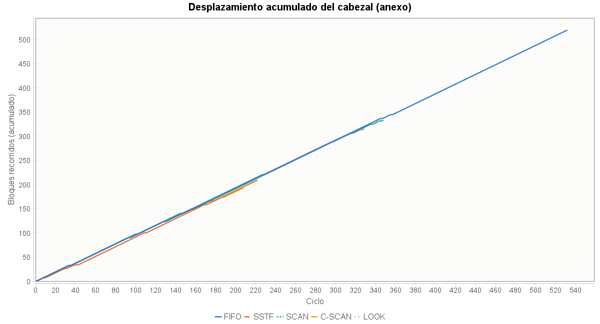

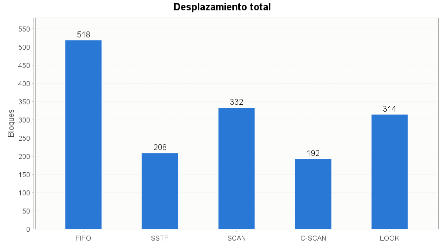

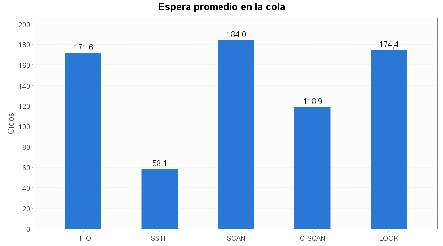

## 2. Casos P1 a P4 (las 8 solicitudes en cola)

Disco de 200 bloques, cabezal en el 50 subiendo, 1 posición por ciclo, solicitudes de 1 bloque: 95, 180, 34, 119, 11, 123, 62, 64.

| Política | Orden de atención | Desplazamiento | Espera promedio | Espera máxima | Ciclos |
| --- | --- | ---: | ---: | ---: | ---: |
| FIFO | 95, 180, 34, 119, 11, 123, 62, 64 | 644 | 321,0 | 657 | 660 |
| SSTF | 62, 64, 34, 11, 95, 119, 123, 180 | 236 | 88,3 | 194 | 252 |
| SCAN | 62, 64, 95, 119, 123, 180, 34, 11 | 337 | 93,0 | 331 | 355 |
| C-SCAN | 62, 64, 95, 119, 123, 180, 11, 34 | 183 | 73,8 | 177 | 201 |
| LOOK | 62, 64, 95, 119, 123, 180, 34, 11 | 299 | 85,6 | 292 | 316 |

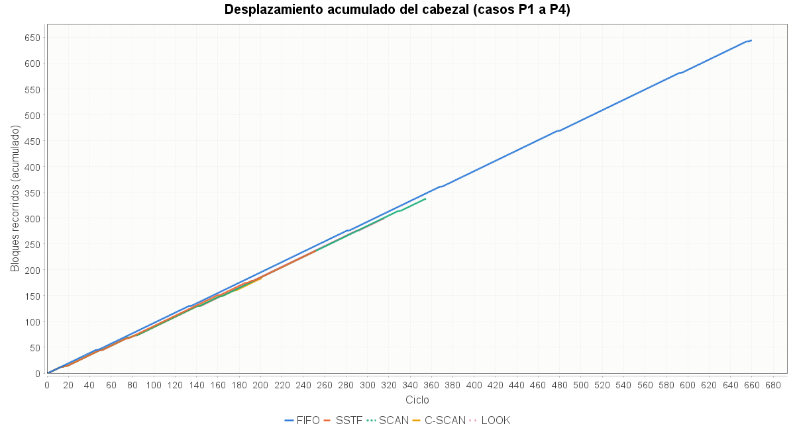

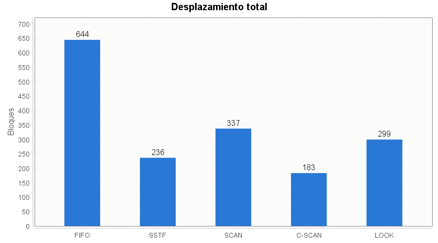

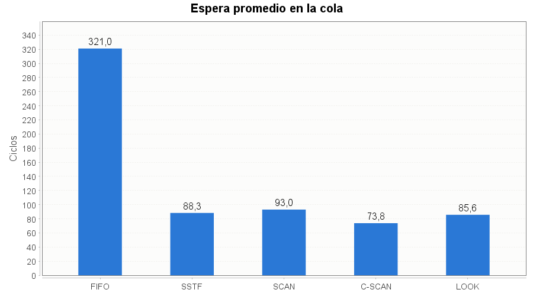

## 3. Sistema completo con los dos JSON del enunciado, cabezal a 5 posiciones por ciclo

8 procesos de E/S, FCFS en CPU, 1024 MB de RAM, deadline 500.

| Política de disco | Terminan bien | Mueren por deadline | Solicitudes atendidas | Desplazamiento | Espera promedio en disco | Ciclos totales | Uso de CPU |
| --- | ---: | ---: | ---: | ---: | ---: | ---: | ---: |
| FIFO | 8 de 8 | 0 | 8 | 644 | 106,3 | 246 | 6,5 % |
| SSTF | 8 de 8 | 0 | 8 | 299 | 69,4 | 177 | 9,0 % |
| SCAN | 8 de 8 | 0 | 8 | 537 | 91,0 | 226 | 7,1 % |
| C-SCAN | 8 de 8 | 0 | 8 | 313 | 72,4 | 182 | 8,8 % |
| LOOK | 8 de 8 | 0 | 8 | 299 | 69,9 | 178 | 9,0 % |

Orden en que el disco atendió los bloques:

- FIFO: 95, 180, 34, 119, 11, 123, 62, 64
- SSTF: 95, 119, 123, 180, 64, 62, 34, 11
- SCAN: 95, 119, 123, 180, 64, 62, 34, 11
- C-SCAN: 95, 119, 123, 180, 11, 34, 62, 64
- LOOK: 95, 119, 123, 180, 64, 62, 34, 11

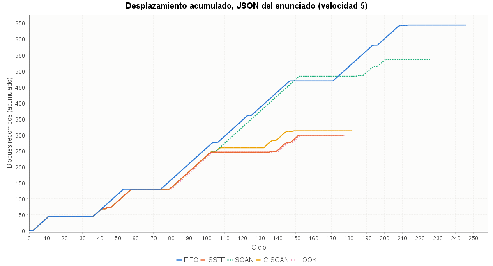

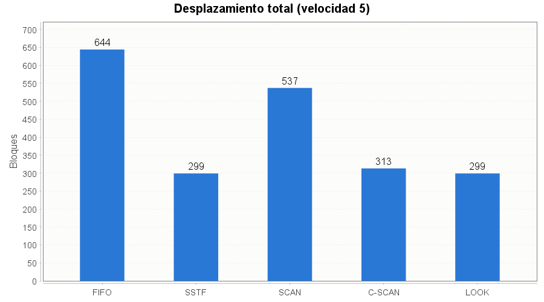

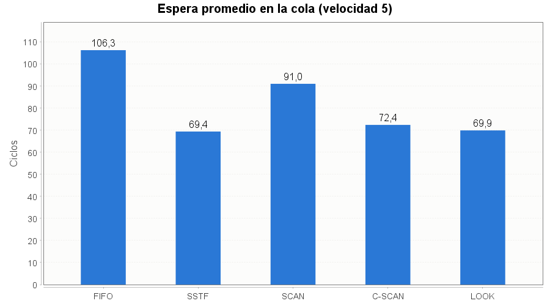

## 4. Sistema completo con los dos JSON del enunciado, cabezal a 1 posición por ciclo (valor por defecto)

8 procesos de E/S, FCFS en CPU, 1024 MB de RAM, deadline 500.

| Política de disco | Terminan bien | Mueren por deadline | Solicitudes atendidas | Desplazamiento | Espera promedio en disco | Ciclos totales | Uso de CPU |
| --- | ---: | ---: | ---: | ---: | ---: | ---: | ---: |
| FIFO | 4 de 8 | 4 | 4 | 448 | 139,5 | 500 | 2,4 % |
| SSTF | 8 de 8 | 0 | 8 | 299 | 177,0 | 413 | 3,9 % |
| SCAN | 4 de 8 | 4 | 4 | 446 | 62,5 | 500 | 2,4 % |
| C-SCAN | 8 de 8 | 0 | 8 | 313 | 200,3 | 429 | 3,7 % |
| LOOK | 8 de 8 | 0 | 8 | 299 | 177,5 | 414 | 3,9 % |

Orden en que el disco atendió los bloques:

- FIFO: 95, 180, 34, 119, 11
- SSTF: 95, 119, 123, 180, 64, 62, 34, 11
- SCAN: 95, 119, 123, 180, 64
- C-SCAN: 95, 119, 123, 180, 11, 34, 62, 64
- LOOK: 95, 119, 123, 180, 64, 62, 34, 11

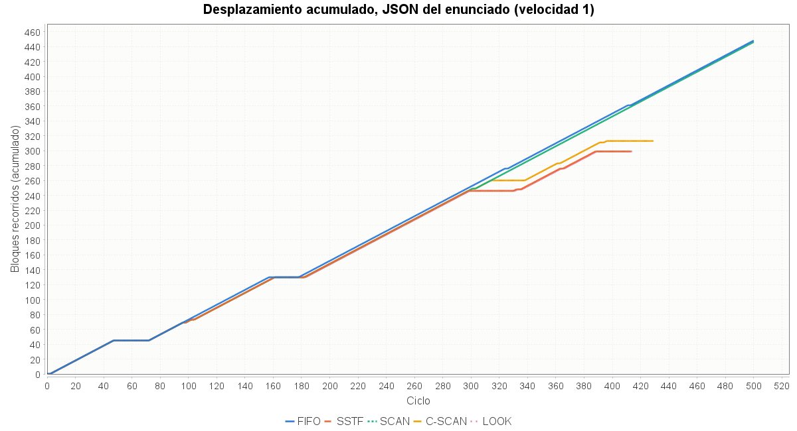

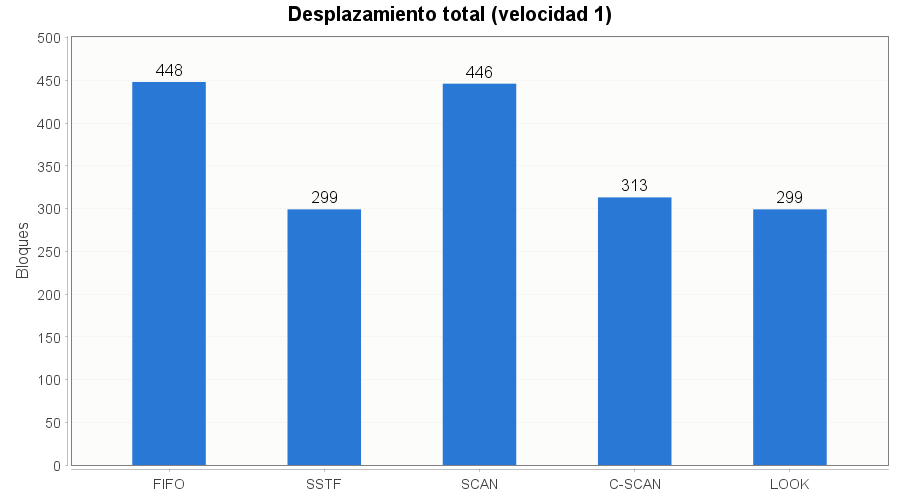

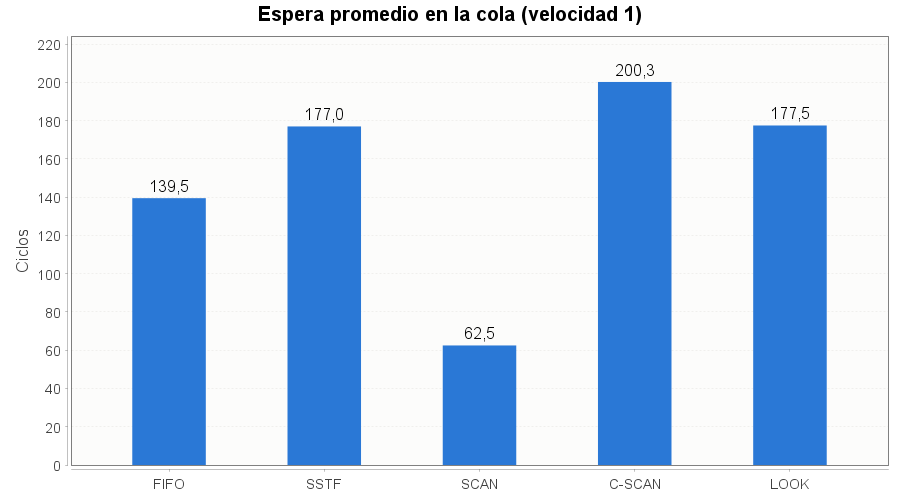

## 5. Suspensión: `suspension.json` (3 procesos, 128 MB)

Política de disco FIFO, FCFS en CPU, cabezal a 10 posiciones por ciclo. La columna "Urgente" muestra cuándo ese proceso entra a RAM y cuándo termina.

| Escenario | Suspensiones | Reactivaciones | Urgente: admitido / termina | Ciclos totales | Uso de CPU | Respuesta promedio | Desplazamiento | Solicitudes al disco |
| --- | ---: | ---: | ---: | ---: | ---: | ---: | ---: | ---: |
| 128 MB con planificador a mediano plazo | 2 | 2 | 129 / 173 | 502 | 2,6 % | 46,0 | 560 | 5 |
| 128 MB sin suspensión | 0 | 0 | 309 / 342 | 342 | 3,8 % | 106,0 | 45 | 1 |
| 1024 MB (la RAM sobra) | 0 | 0 | 1 / 40 | 309 | 4,2 % | 5,3 | 45 | 1 |

## 6. Suspensión con más carga: `carga_suspension.json` (6 procesos, 128 MB)

Política de disco FIFO, FCFS en CPU, cabezal a 10 posiciones por ciclo. La columna "Calculo_1" muestra cuándo ese proceso entra a RAM y cuándo termina.

| Escenario | Suspensiones | Reactivaciones | Calculo_1: admitido / termina | Ciclos totales | Uso de CPU | Respuesta promedio | Desplazamiento | Solicitudes al disco |
| --- | ---: | ---: | ---: | ---: | ---: | ---: | ---: | ---: |
| 128 MB con planificador a mediano plazo | 2 | 2 | 59 / 140 | 653 | 39,1 % | 73,5 | 270 | 4 |
| 128 MB sin suspensión | 0 | 0 | 459 / 540 | 708 | 36,0 % | 275,5 | 0 | 0 |
| 1024 MB (la RAM sobra) | 0 | 0 | 1 / 90 | 565 | 45,1 % | 48,5 | 0 | 0 |

## 7. `carga_suspension.json` con cada política de disco (128 MB, con suspensión)

| Política de disco | Suspensiones | Reactivaciones | Desplazamiento | Espera promedio en disco | Ciclos totales | Uso de CPU |
| --- | ---: | ---: | ---: | ---: | ---: | ---: |
| FIFO | 2 | 2 | 270 | 0,3 | 653 | 39,1 % |
| SSTF | 2 | 2 | 270 | 0,3 | 653 | 39,1 % |
| SCAN | 2 | 2 | 788 | 7,8 | 695 | 36,7 % |
| C-SCAN | 2 | 2 | 489 | 2,3 | 653 | 39,1 % |
| LOOK | 2 | 2 | 270 | 0,8 | 654 | 39,0 % |

